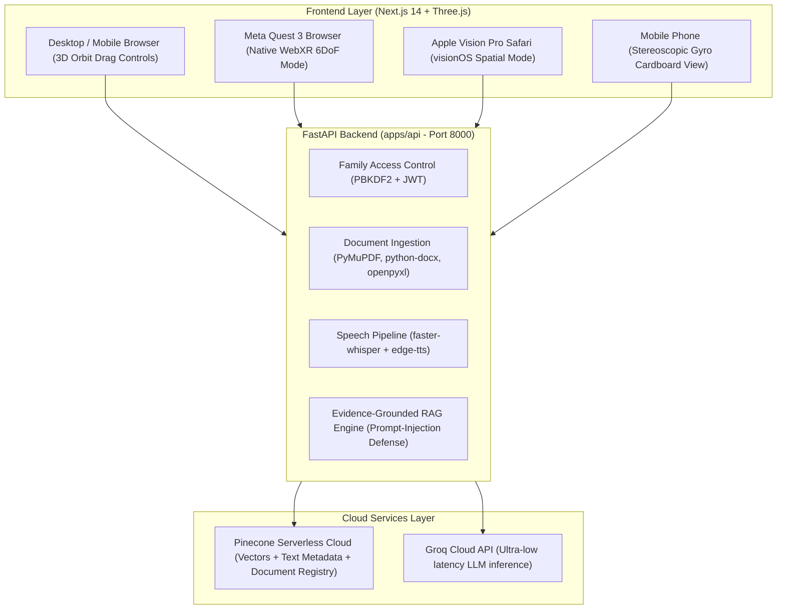

# Aurora Spatial Financial RAG (Australia)
## Complete Developer & Operations Runbook

**Jurisdiction:** Australia (Cth)  
**Target Currency:** Australian Dollar (AUD, $)  
**Frontend Architecture:** Option 4 — Aurora Spatial HUD (Next.js 14, Three.js, WebXR)  
**Backend Architecture:** FastAPI (Python 3.11), Pinecone (Serverless Vector Index & Metadata), Groq Cloud API (Llama 3.3 / OSS), faster-whisper & edge-tts (Voice)

---

## 1. System Overview



---

## 2. Prerequisites

1. **Python:** 3.11+ (Python 3.11.9 verified on host).
2. **Node.js:** v18+ (v24.20.0 with npm 11.19.0 verified on host).
3. **Pinecone Account:** Free API key from [pinecone.io](https://www.pinecone.io).
4. **Groq Cloud Account:** API key from [console.groq.com](https://console.groq.com).

---

## 3. Configuration Setup (`.env`)

At the project root (`d:\VR-RAG\.env`), create your local `.env` file by copying `.env.example`:

```bash
# In project root d:\VR-RAG
copy .env.example .env
```

Ensure the following variables are configured:
```ini
# 1. Pinecone Vector Database
PINECONE_API_KEY=your-actual-pinecone-api-key-here
PINECONE_INDEX_NAME=australian-financial-rag
PINECONE_CLOUD=aws
PINECONE_REGION=us-east-1

# 2. Local Ollama LLM
OLLAMA_BASE_URL=http://localhost:11434
OLLAMA_MODEL=llama3.2

# 3. Backend & SQLite
API_HOST=127.0.0.1
API_PORT=8000
ENVIRONMENT=development
APP_SECRET_KEY=change-this-to-a-secure-random-32-char-key
SQLITE_DB_PATH=../../data/app.db

# 4. Frontend
NEXT_PUBLIC_API_URL=http://localhost:8000
NEXT_PUBLIC_DEFAULT_CURRENCY=AUD
```

---

## 4. Running the Application

### A. Start the Local LLM (Ollama)
In a dedicated PowerShell terminal:
```powershell
ollama serve
```
*(Ensure `llama3.2` is pulled by running `ollama pull llama3.2` if not already installed).*

### B. Start the Python FastAPI Backend (`apps/api`)
In a second terminal:
```powershell
cd d:\VR-RAG\apps\api
.\.venv\Scripts\Activate.ps1
uvicorn app.main:app --reload --host 127.0.0.1 --port 8000
```
* **API Documentation:** Visit [http://localhost:8000/docs](http://localhost:8000/docs) to inspect the Swagger UI.
* **Health Check:** Visit [http://localhost:8000/api/health](http://localhost:8000/api/health).

### C. Start the Next.js Frontend (`apps/web`)
In a third terminal:
```powershell
cd d:\VR-RAG\apps\web
npm run dev
```
* **Frontend Cockpit:** Open [http://localhost:3000](http://localhost:3000) in your browser.

### D. Start the Expo Mobile App (`apps/mobile`)
In a fourth terminal:
```powershell
cd d:\VR-RAG\apps\mobile
npx expo start
```
* **Expo Go:** Scan the interactive QR code with your iOS Camera or Android Expo Go app.
* **Android Emulator:** Press `a` in terminal to launch in an Android Virtual Device (AVD).
* **iOS Simulator:** Press `i` in terminal to launch in iOS Simulator (macOS).
* **Web Preview:** Press `w` in terminal to test the mobile layout in your browser.

---

## 5. Running the Automated Test Suites

To execute the backend verification tests (ACL role isolation, document ingestion, and speech processing):
```powershell
cd d:\VR-RAG\apps\api
.\.venv\Scripts\pytest.exe -v
```

To run the Next.js production build check:
```powershell
cd d:\VR-RAG\apps\web
npm run build
```

---

## 6. How to Test the YouTube-Style "View in VR" Feature

### 1. Standard Desktop / Laptop Browser
* Open [http://localhost:3000](http://localhost:3000).
* The 3D financial vault room renders directly inside the viewport.
* **Orbit Controls:** Click and drag with your mouse to orbit the 3D room, inspect the central neon core, and view the floating data pillars.
* Click the glowing **"VIEW IN VR"** button in the top navigation bar to open the launcher modal. It will display a dynamic QR code and direct session URL for pairing with your headset.

### 2. Meta Quest 2 / 3 / Pro Headset
* Put on your Meta Quest headset.
* Open the **Meta Quest Browser**.
* Navigate to your local machine's IP (e.g. `http://<YOUR_LOCAL_IP>:3000`).
* Click **"VIEW IN VR"** $\rightarrow$ Click **"Launch Immersive 6DoF VR Session"**.
* You will enter full room-scale 6DoF VR. Controller laser rays will automatically appear on your Quest Touch controllers.

### 3. Apple Vision Pro (visionOS Safari)
* Open **Safari** on Apple Vision Pro.
* Navigate to the application URL.
* Tap **"VIEW IN VR"** $\rightarrow$ Tap **"Launch Immersive VR Session"**.
* visionOS will transition the viewport into an immersive spatial computing environment.

### 4. Mobile Phone (Google Cardboard / Gyro Mode)
* Open the URL on your iPhone or Android phone.
* Tap **"VIEW IN VR"** $\rightarrow$ Tap **"Launch Mobile Cardboard Stereo View"**.
* The screen splits into a dual-barrel stereoscopic view with ~64mm interpupillary distance. Place your phone inside a Cardboard headset. Turning your head rotates your view in 3D using your phone's gyroscope!

---

## 7. Australian Privacy & Regulatory Compliance Alignment

1. **Australian Privacy Principles (APPs) & Cross-Border Data Disclosure (APP 8):**
   * **Local Storage:** Original raw documents, SQLite relational databases (`data/app.db`), and BM25 disk indices (`data/lexical/`) remain strictly on the host system.
   * **Cloud Services & Data Flows:** In accordance with APP 8, family office operators must note that:
     - Vector indexing transfers mathematical embeddings along with passage chunk text to Pinecone Serverless in AWS `us-east-1` (US).
     - RAG inference sends query prompts and retrieved evidence passages to Groq Cloud LLM APIs (`llama-3.3-70b-versatile`).
     - Voice interactions stream audio to Groq Whisper STT and receive audio synthesized by Microsoft Edge-TTS cloud service.
     - Deployers should ensure appropriate DPAs, security controls, and client disclosures are in place prior to handling sensitive personal information.
2. **ASIC RG 244 Factual Information Standard:**
   * The assistant enforces prominent headers and response notices stating that outputs are purely factual summaries extracted from uploaded documents and do not constitute personal financial product advice.
3. **Prompt-Injection Defense:**
   * Document excerpts are sanitized and wrapped in strict `<evidence>` boundary tags. The LLM is instructed never to execute commands or overrides found within document bodies.
