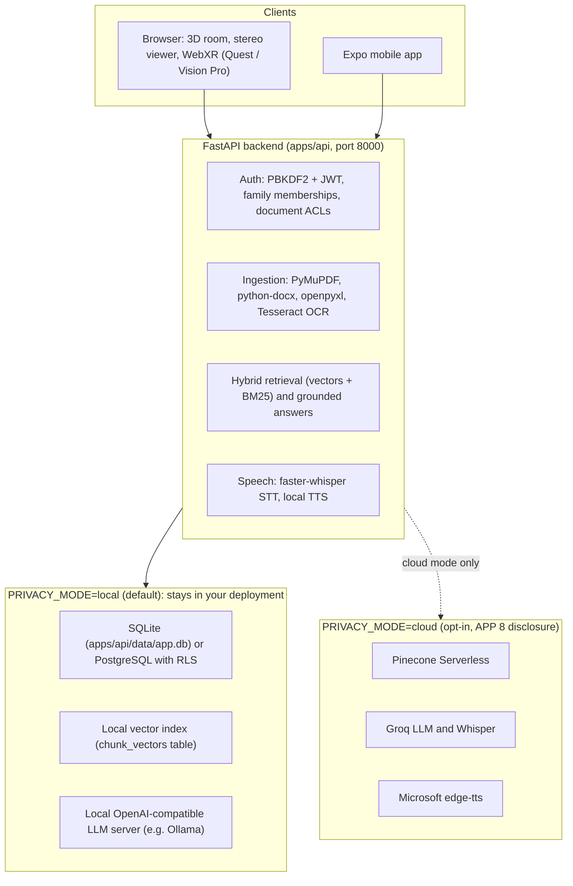

# Aether Sovereign (VR-RAG)
## Developer & Operations Runbook

**Jurisdiction:** Australia (Cth)
**Currency:** Australian Dollar (AUD, $)
**Frontend:** Next.js 14, Three.js, WebXR (`apps/web`); Expo React Native (`apps/mobile`)
**Backend:** FastAPI on Python 3.11 (`apps/api`), SQLite or PostgreSQL, local vector index, faster-whisper

Paths in this runbook are relative to the repository root. The README's [Privacy modes](../README.md#privacy-modes)
section is the authoritative description of where data goes.

---

## 1. System Overview



---

## 2. Prerequisites

1. **Python 3.11** (the version CI uses; newer versions also work locally).
2. **Node.js 20** (CI) or newer, with npm.
3. **Tesseract OCR** on the PATH, for scanned PDFs and images.
4. **Local mode:** an OpenAI-compatible LLM server, for example [Ollama](https://ollama.com).
5. **Cloud mode only:** Pinecone and Groq API keys.
6. **Optional:** Docker, to run the whole stack with `docker compose`, or for PostgreSQL.

---

## 3. Configuration (`.env`)

Copy the template at the repository root and fill it in:

```bash
cp .env.example .env
```

`.env.example` documents every variable. The important ones:

```ini
# Required: at least 32 random characters
APP_SECRET_KEY=
# development | test | production (production refuses weak secrets and superuser DB roles)
ENVIRONMENT=development

# Privacy: local (default) or cloud
PRIVACY_MODE=local
LLM_PROVIDER=local
LOCAL_LLM_BASE_URL=http://127.0.0.1:11434/v1
LOCAL_LLM_MODEL=qwen3:8b

# Database: unset for SQLite at apps/api/data/app.db, or PostgreSQL
# DATABASE_URL=postgresql+psycopg://vrrag_app:<password>@127.0.0.1:5432/vr_rag

# Cloud mode only
PINECONE_API_KEY=
GROQ_API_KEY=

# Web client (compiled into the browser bundle)
NEXT_PUBLIC_API_URL=http://localhost:8000
```

Relative `SQLITE_DB_PATH` and `UPLOADS_DIR` values resolve against `apps/api`, so the database, uploads and
keyword index live in `apps/api/data/` whichever folder you start from. Use an absolute path to keep them elsewhere.

With `DATABASE_URL` set, the API runs the Alembic migrations at startup and refuses to start if row-level security
is not enforced or if the database role is a superuser or has BYPASSRLS (allowed with a warning in development).

---

## 4. Running the Application

### A. Docker (whole stack)
```bash
docker compose up --build
```
This starts PostgreSQL, the API (port 8000) and the web app (port 3000). Set `APP_SECRET_KEY`,
`POSTGRES_ADMIN_PASSWORD` and `APP_DB_PASSWORD` in `.env` first. In local mode the API reaches an LLM server on
the host at `http://host.docker.internal:11434/v1` (override with `DOCKER_LOCAL_LLM_BASE_URL`).

### B. Local LLM (local mode)
```bash
ollama pull qwen3:8b
ollama serve
```

### C. Backend (`apps/api`)
```bash
cd apps/api
python -m venv .venv
.venv/Scripts/activate        # Windows; on macOS/Linux: source .venv/bin/activate
pip install -r requirements.txt
python -m uvicorn app.main:app --host 127.0.0.1 --port 8000 --reload
```
* **API documentation:** [http://localhost:8000/docs](http://localhost:8000/docs)
* **Health check:** [http://localhost:8000/api/health](http://localhost:8000/api/health) reports `privacy_mode` and
  `data_leaves_deployment`. Component details are at `/api/health/details` (family admins only).
* Documents indexed before local mode existed need local vectors: `python -m app.scripts.build_local_vectors`.

### D. Web frontend (`apps/web`)
```bash
cd apps/web
npm ci
npm run dev
```
Open [http://localhost:3000](http://localhost:3000).

### E. Mobile app (`apps/mobile`)
```bash
cd apps/mobile
npm ci
npx expo start
```
Set `EXPO_PUBLIC_API_URL` to an address the phone can reach (for example `http://<YOUR_LAN_IP>:8000`). Press `a`
for an Android emulator, `i` for the iOS simulator (macOS), `w` for a browser preview, or scan the QR code with
Expo Go.

---

## 5. Tests and Checks

These are the same checks CI runs (`.github/workflows/ci.yml`).

```bash
cd apps/api
python -m pytest -q
```
The suite runs offline: `tests/conftest.py` blocks outbound network and blanks cloud keys. The embedding model
must already be downloaded once (any normal run of the API does this).

PostgreSQL tests run when `TEST_DATABASE_URL` points at a database owned by a non-superuser role:
```bash
TEST_DATABASE_URL=postgresql+psycopg://vrrag_app:<password>@127.0.0.1:5432/vrrag \
  python -m pytest -q tests/db tests/test_token_budget_usage.py tests/test_lexical_rebuild.py
```

Clients:
```bash
cd apps/web && npx tsc --noEmit && npm run build
cd apps/mobile && npx tsc --noEmit
```

Note that a test run rewrites the generated files in `apps/api/evals/corpus`; restore them afterwards with
`git checkout -- apps/api/evals/corpus`.

---

## 6. "View in VR"

Click **VR** in the top bar to open the **View in VR** launcher. VR is optional; when the device has no WebXR
support the launcher says so and offers **Open Spatial Room** (desktop 3D) instead.

### 1. Desktop or laptop browser
* The 3D room renders in the page; drag to orbit.
* In the launcher, **Stereo preview** opens the side-by-side stereo viewer.
  Move with the WASD keys.

### 2. Meta Quest or Apple Vision Pro
* Open the app in the headset browser (Meta Quest Browser or visionOS Safari).
* When the browser supports WebXR, the launcher shows **Enter VR**, which starts an
  immersive 6DoF session.
* Browsers only expose WebXR on secure origins, so serve the app over HTTPS (or `localhost`) for this option to
  appear. A plain `http://<YOUR_LAN_IP>:3000` address falls back to the stereo viewer.

### 3. Phone (Cardboard-style viewer)
* Open the app on the phone and use **Stereo preview**.
* The screen splits into a stereo pair (64 mm interpupillary distance) and the view follows the phone's
  gyroscope; place the phone in a Cardboard-style headset.

---

## 7. Australian Privacy & Regulatory Alignment

1. **Australian Privacy Principles, including APP 8 (cross-border disclosure):**
   * **`PRIVACY_MODE=local` (default):** documents, vectors, prompts and audio stay within the deployment.
     Original files and the keyword index are on local disk (`apps/api/data/`), records and vectors are in the
     app database, and answers come from the local LLM server. Cloud settings are ignored.
   * **`PRIVACY_MODE=cloud` (opt-in):** embeddings with full chunk text go to Pinecone (AWS `us-east-1` by
     default); questions and retrieved evidence go to the configured Groq model; voice audio goes to Groq
     Whisper, and answers are synthesised by Microsoft edge-tts. Optional S3 storage and AWS Textract OCR apply
     when configured. Operators must obtain client consent and hold Data Processing Agreements before enabling it.
2. **ASIC RG 244 factual information:** the web client displays notices that answers are factual summaries of the
   uploaded documents and not personal financial product advice.
3. **Prompt-injection defence:** document text is sanitised (`app/services/prompt_guard.py`) and wrapped in
   `<evidence>` tags; the model is instructed never to follow instructions found inside documents, and its
   reasoning output is stripped before anything reaches the client.
